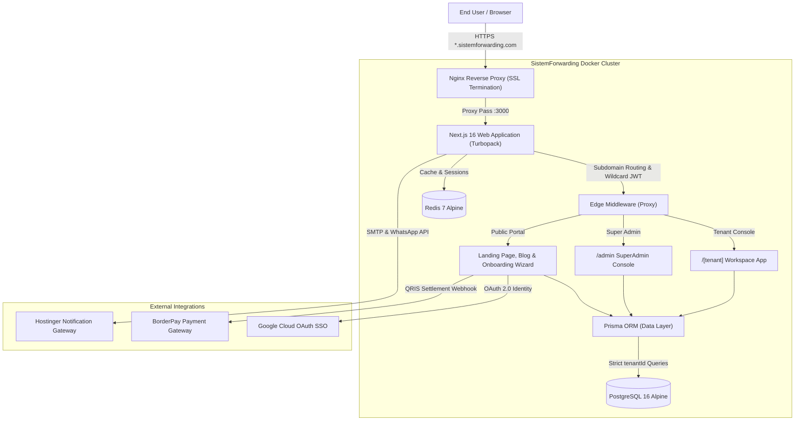

# SistemForwarding.com — Autopilot B2B SaaS Freight Forwarding ERP

[-black?style=for-the-badge&logo=next.js)](https://nextjs.org/)
[](https://react.dev/)
[](https://www.typescriptlang.org/)
[](https://www.prisma.io/)
[](https://www.postgresql.org/)
[](https://www.docker.com/)

**SistemForwarding.com** is a modern, high-performance, cloud-native B2B Multi-Tenant Freight Forwarding ERP and Logistics Operating System. Designed specifically for Indonesian and international logistics providers, ocean carriers, air cargo expediters, and inland trucking operators, the platform transforms manual, error-prone spreadsheets into a unified, autopilot operational suite.

The system features strict tenant data isolation, dynamic subdomains (`[subdomain].sistemforwarding.com`), automated master prefix sequence generation, Indonesian tax compliance (**PMK No. 71/PMK.03/2022 PPN 1.1% & PPN 11%**), automated vector PDF generation (**Air Waybills & Commercial Invoices**), financial reporting (**P&L and Aging Cash Flow**), Excel exports, real-time animated telemetry dashboards (**Recharts**), and a fully automated self-service onboarding wizard with **BorderPay QRIS** payment gateway integration.

---

## 🌟 Executive Highlights

- **Multi-Tenant Subdomain Routing:** Native wildcard DNS routing (`*.sistemforwarding.com`) powered by Next.js edge middleware and Nginx reverse proxy. Each client operates within their private, white-labeled workspace (`demo1.sistemforwarding.com`, `acme.sistemforwarding.com`).
- **Strict Database-Level Isolation:** Every operational, master data, and financial table in PostgreSQL 16 is indexed and partitioned by `tenantId`. Zero risk of cross-tenant data leaks.
- **Multimodal Freight Dispatch:** Unified management for **Sea Freight (FCL / LCL)**, **Air Cargo Express**, and **Inland Trucking / Haulage**, tracking routing telemetry from Port of Loading (POL) to Port of Discharge (POD) with vessel/flight tracking and customs clearance statuses.
- **Automated Sequence & Prefix Engine:** Configurable auto-incrementing patterns (`{PREFIX}/{YEAR}/{MONTH}/{SEQ}`) per tenant for Job Files (`JF/2026/10/00001`), Commercial Invoices (`INV/2026/00001`), and Payment Vouchers (`PV/2026/10/00001`).
- **Indonesian Tax Compliance (PMK 71):** Built-in support for Freight Forwarding Final VAT (PPN Jasa Pengurusan Transportasi 1.1%) as well as Standard VAT (11% / 12%), calculating base taxable amounts (*DPP Nilai Lain*) and tax outputs automatically.
- **Server-Side Vector PDF Engine (`pdfmake`):** Generates print-ready, pixel-perfect documents with dynamic tenant letterheads, logos, payment remittance details, and official IATA / FIATA cargo layouts.
- **Financial Analytics & Excel Reporting (`exceljs`):** Export master tables (Customers, Vendors, Job Files, Invoices) to formatted `.xlsx` workbooks, alongside real-time Gross Margin / Monthly P&L and Cash Flow Aging summaries.
- **Zero Mock Interactive Animated Telemetry (`recharts`):** 100% database-driven dashboard featuring interactive Area Charts (Revenue vs Gross Profit), Bar Charts (BL volume), Grouped Bar Charts (AR vs AP), and interactive Donut Charts for multimodal distribution with active hover shape expansion.
- **Self-Serve Onboarding & Automated Payment:** Complete 3-step registration flow: Google SSO -> Tenant Subdomain Reservation -> Automated QRIS generation via BorderPay with background webhook listeners.

---

## 🏗️ System Architecture



---

## 📦 Core Functional Modules

### 1. Operations & Job File Management
- **Lifecycle Tracking:** Draft &rarr; Booked &rarr; In-Transit &rarr; Customs Clearance &rarr; Arrived &rarr; Delivered &rarr; Closed.
- **Multimodal Routing:** Origin Port, Destination Port, Transit Ports, Transshipment hubs, Carrier/Vessel name, Flight number, Voyage, and ETA/ETD schedules.
- **Cargo Packaging & Weights:** Gross Weight (KG), Net Weight, Chargeable Weight (VGM), Volume (CBM), Container numbers (20ft, 40ft, 40HC, Reefer), Seal numbers, Package counts, and Dangerous Goods (DG) class classification.
- **Incoterms Support:** Standard ICC terms: EXW, FOB, CFR, CIF, CIP, CPT, DAP, DPU, DDP.

### 2. Commercial Invoicing & AR/AP Ledger
- **Accounts Receivable (AR):** Selling freight charges, trucking haulage, Terminal Handling Charges (THC), documentation fees, and customs clearance services billed to shippers/consignees.
- **Accounts Payable (AP / COGS):** Buying rates and disbursements owed to shipping lines, airlines, truckers, and third-party customs brokers (PPJK).
- **Automated Profit Margins:** Computes Gross Margin ($Revenue - COGS$) and Margin Percentage per shipment and consolidates monthly performance.
- **Multi-Currency Converter:** Real-time conversion between Indonesian Rupiah (IDR), US Dollar (USD), Singapore Dollar (SGD), and Euro (EUR) with configurable tenant exchange rates.

### 3. Document Generation (PDF Engine)
- **Endpoint:** `GET /api/[tenant]/invoice/[id]/pdf`
  - Generates official Commercial Invoices with tenant corporate letterhead, logo, Customer Bill-To, Charge Code line items, currency breakdowns, PPN 1.1% / 11% taxes, payment terms, and bank remittance instructions.
- **Endpoint:** `GET /api/[tenant]/jobs/[id]/awb-pdf`
  - Generates standardized Air Waybill (AWB) and Ocean Bill of Lading (B/L) shipping manifests conforming to international logistics standards (Shipper, Consignee, Notify Party, Routing, Carrier, Handling Information, Commodity description, and HS Code).

### 4. Financial Reports & Excel Data Export
- **Endpoint:** `GET /api/[tenant]/export/[entity]?format=xlsx`
  - Exports `customers`, `vendors`, `jobs`, or `invoices` into styled Excel worksheets with header styling, monetary formatting, and column auto-sizing.
- **Endpoint:** `GET /api/[tenant]/export/reports?type=profit-loss`
  - Generates a categorized Monthly Profit & Loss analysis classified by Sea Freight, Air Cargo, and Inland Trucking.
- **Endpoint:** `GET /api/[tenant]/export/reports?type=cashflow`
  - Generates an Aging Cash Flow schedule classifying receivables and payables by due dates (< 30 days, 31–60 days, > 60 days overdue).

### 5. Interactive Animated Telemetry Dashboard
- **Omset & Laba (Area Chart):** Smooth dual-gradient curves comparing Gross Receivables (AR) against Net Gross Margin.
- **Volume BL (Bar Chart):** Interactive monthly shipment volume bars highlighting the active period.
- **AR vs AP (Grouped Bar Chart):** Side-by-side comparison of customer invoices vs vendor liabilities.
- **Distribusi Moda Kargo (Donut Chart):** Dynamic pie chart with animated hover expansion (*active shape slice zoom*), central percentage telemetry, and interactive clickable legends.

### 6. Automated Onboarding & BorderPay QRIS Gateway
- **Step 1 — Google SSO:** Official popup authentication linking the organization administrator.
- **Step 2 — Workspace Details:** Company name and instant PostgreSQL subdomain availability check.
- **Step 3 — QRIS Payment:** Generates an authentic scannable QRIS code with 30-minute expiration. An automated background listener (`checkPaymentStatus`) polls every 2.5 seconds, instantly transitioning to the workspace upon payment settlement.
- **Webhook Callback (`POST /api/webhooks/borderpay`):** Validates the `x-borderpay-token` secret header, automatically switches tenant subscription status to `ACTIVE`, updates expiration dates (+1 month or +1 year), and dispatches confirmation emails and WhatsApp alerts.

---

## 🗄️ Database Entity Schema (Prisma ORM)

```
Tenant (Primary Multi-Tenant Boundary)
├── User (Roles: SUPERADMIN, TENANT_ADMIN, OPERATOR, FINANCE, MANAGEMENT)
├── MasterPrefix (JOB_FILE, INVOICE, PAYMENT_VOUCHER)
├── MasterTax (PPN_JPT_1_1, PPN_11, etc.)
├── MasterCurrency (IDR Base, USD, SGD)
├── FinancialSettings (Terms, Lock Periods, Accounting Policies)
├── MasterCustomer (Shippers, Consignees, Importers/Exporters)
├── MasterVendor (Shipping Lines, Airlines, Trucking Companies, PPJK)
├── MasterPort (Seaports, International Cargo Airports, Dry Ports)
├── MasterChargeCode (Freight, Trucking, THC, Storage, EDI, Demurrage)
├── JobFile (Core Operational Shipment Record)
│   ├── JobCargoDetail (Dimensions, Gross/Net Weight, Units, Commodities)
│   └── Invoice (Commercial Billing)
│       └── InvoiceItem (Charge Breakdown, Rates, Taxable Amount)
└── SystemDictionary (System Options & Reference Keys)
```

---

## 🛠️ Technology Stack

| Layer | Technologies |
|---|---|
| **Frontend Framework** | [Next.js 16.4.3](https://nextjs.org/) (App Router, Server Actions, Turbopack) |
| **UI & Styling** | [React 19](https://react.dev/), [Tailwind CSS 3.4](https://tailwindcss.com/), [Lucide React Icons](https://lucide.dev/) |
| **Data Visualization** | [Recharts 3.10](https://recharts.org/) (Animated SVG Canvas & Custom Tooltips) |
| **Backend & Runtime** | [Node.js 22 LTS](https://nodejs.org/), TypeScript 5.7 |
| **ORM & Database** | [Prisma ORM 6.x](https://www.prisma.io/), [PostgreSQL 16 Alpine](https://www.postgresql.org/) |
| **Cache & Sessions** | [Redis 7 Alpine](https://redis.io/), [Jose JWT](https://github.com/panva/jose) (Wildcard Cookies) |
| **Document Processing** | [pdfmake](https://pdfmake.github.io/docs/), [exceljs](https://github.com/exceljs/exceljs), [qrcode](https://github.com/soldair/node-qrcode) |
| **Reverse Proxy & SSL** | [Nginx Alpine](https://nginx.org/), Let's Encrypt Wildcard Certificates |
| **Containerization** | [Docker](https://www.docker.com/), Docker Compose |

---

## 🚀 Getting Started & Local Development

### Prerequisites
- [Node.js 22.x LTS](https://nodejs.org/) or higher
- [Docker](https://www.docker.com/) & Docker Compose
- [Git](https://git-scm.com/)

### 1. Clone the Repository
```bash
git clone https://github.com/nopecode96/sistemforwarding.com.git
cd sistemforwarding.com
```

### 2. Configure Environment Variables
Copy the template configuration:
```bash
cp .env.example .env
```
Ensure you update database passwords, JWT secrets, Google OAuth credentials, and BorderPay tokens according to your environment.

### 3. Start the Database & Infrastructure via Docker
```bash
docker compose up -d postgres redis
```

### 4. Install Dependencies & Initialize Database
```bash
cd app
npm install
npx prisma generate
npx prisma db push
npx prisma db seed
```

### 5. Run the Local Development Server
```bash
npm run dev
```
The application will start at `http://localhost:3000`.

To test subdomain routing locally, map test subdomains in your `/etc/hosts` file:
```
127.0.0.1  sistemforwarding.localhost
127.0.0.1  demo1.sistemforwarding.localhost
127.0.0.1  demo2.sistemforwarding.localhost
127.0.0.1  admin.sistemforwarding.localhost
```

---

## 🐳 Production Deployment (Docker Compose)

The entire production stack runs as isolated container services defined in `docker-compose.yml`:

```bash
# Build and start all services in detached mode
docker compose up -d --build

# Verify running containers
docker compose ps

# Check Next.js application logs
docker compose logs -f app
```

### Docker Service Topology:
- **`sf_nginx`**: Nginx reverse proxy listening on ports 80 & 443 with wildcard SSL termination.
- **`sf_app`**: Next.js 16 containerized application listening on internal port 3000.
- **`sf_postgres`**: PostgreSQL 16 database with persistent storage volume mounted at `./data/postgres`.
- **`sf_redis`**: Redis 7 in-memory cache mounted at `./data/redis`.

---

## 📄 License & Intellectual Property

This project is proprietary software developed by **PT. Rafa Kreasindo Teknologi** for **SistemForwarding.com**. All rights reserved.

---

*Engineered with precision for high-volume freight forwarding operations and financial clarity.*
