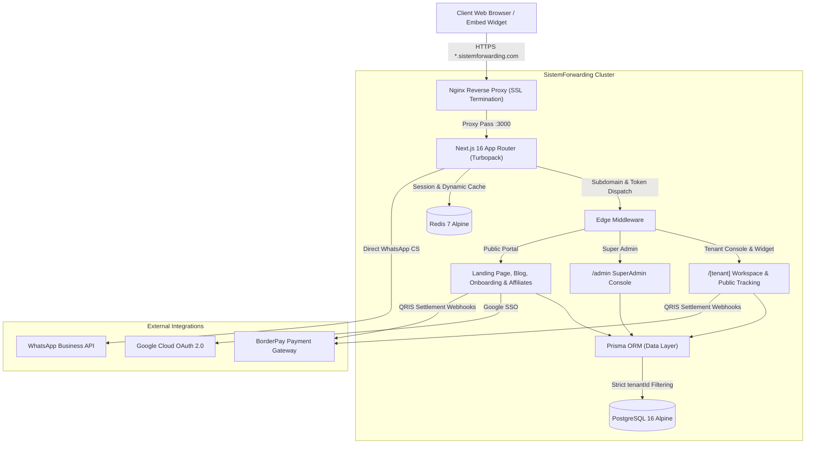

# SistemForwarding.com — Autopilot B2B SaaS Freight Forwarding ERP

[-black?style=for-the-badge&logo=next.js)](https://nextjs.org/)
[](https://react.dev/)
[](https://www.typescriptlang.org/)
[](https://www.prisma.io/)
[](https://www.postgresql.org/)
[](https://www.docker.com/)
[](https://github.com/nopecode96/sistemforwarding.com/releases)

**SistemForwarding.com** is an enterprise-grade, cloud-native B2B Multi-Tenant Freight Forwarding ERP and Logistics Operating System. Specially engineered for international freight forwarders, customs brokerage firms (PPJK / Customs Brokers), ocean carriers, air cargo expediters, and inland trucking operators.

The platform eliminates manual, fragmented spreadsheets by orchestrating operations, multimodal tracking, regulatory customs documentation, financial invoicing (**PMK No. 71/PMK.03/2022 PPN 1.1% & PPN 11%**), automated vector PDF generation (**LX Pantos Standard Air Waybill & Commercial Invoices**), formatted Excel reporting, public no-code tracking widgets, and end-to-end subscription lifecycle billing via **BorderPay QRIS**.

---

## 🌟 Executive Highlights & Core Features

### 1. Dual-Role Architecture: Freight Forwarder & Customs Broker (PPJK)
- **Forwarder & Broker Workflow:** Unified support for both Freight Forwarding services and Customs Brokerage (PPJK clearance), allowing operations to act as cargo agent, customs broker, or dual-role.
- **Relational Entity Mapping:** Distinct separation between **Customer** (Shipper / Consignee / Cargo Owner), **Carrier** (Ocean Shipping Lines, Cargo Airlines, Trucking Fleets, Third-Party Transporters), and **Billing Party** (`SHIPPER`, `CONSIGNEE`, or `OTHER`).
- **Initial Document Attachment:** Direct linking of Shipping Instruction (SI) and Commercial Invoice (CI) references at Job creation, ensuring full audit trail from cargo intake.

### 2. Multi-Tenant Subdomain Routing & Security
- **Wildcard Subdomain Isolation:** Native routing (`[tenant].sistemforwarding.com`) via Next.js Edge Middleware and Nginx reverse proxy.
- **Database Partitioning:** Strict database-level isolation where every operational, master, and financial table is indexed and scoped by `tenantId`.
- **RBAC Matrix:** Built-in role-based access control (`SUPERADMIN`, `TENANT_ADMIN`, `OPERATOR`, `FINANCE`, `MANAGEMENT`).

### 3. Comprehensive Master Data & Reference Dictionary
- **System Dictionary:** Pre-seeded reference dictionaries across 43 operational categories (Unit of Measurement/UoM: `KG`, `CBM`, `TON`, `PCS`, `DRUM`; Incoterms: `EXW`, `FOB`, `CIF`, `DDP`; Item Categories: `GENERAL`, `DANGEROUS_GOODS`, `PERISHABLE`, `REEFER`; Payment Terms: `CASH`, `NET_15`, `NET_30`, `NET_60`).
- **Global Carrier Directory:** Pre-loaded international shipping lines and airlines (Maersk, MSC, CMA CGM, ONE, Evergreen, Garuda Cargo, Singapore Airlines Cargo, etc.) with standardized SCAC / IATA prefixes.
- **Master Prefix Engine:** Tenant-configurable automated numbering sequences (`{PREFIX}/{YEAR}/{MONTH}/{SEQ}`) for Job Files (`JF/2026/10/00001`), Invoices (`INV/2026/00001`), and Payment Vouchers.

### 4. Operational Document Generation (Vector PDF Engine)
- **LX Pantos Standard Air Waybill (AWB):** `GET /api/[tenant]/jobs/[id]/awb-pdf`
  - High-precision IATA/FIATA standard grid layout.
  - Multi-tier cargo rate breakdown (Prepaid, Collect, As Arranged).
  - Chargeable weight calculation ($max(GrossWeight, VolumetricWeight)$), flight/routing schedules, package quantities, and commodity descriptions.
- **Commercial Tax Invoice:** `GET /api/[tenant]/invoice/[id]/pdf`
  - Professional bilingual invoice with tenant letterhead, corporate logo, and verified payment remittance details.
  - Indonesian Freight VAT compliance: Automated **PPN JPT 1.1%** (PMK 71/2022) with *DPP Nilai Lain* and Standard PPN 11%/12%.
  - Embedded QR verification code for authenticity.

### 5. Multi-Entity Formatted Excel Data Exports (`exceljs`)
- Styled `.xlsx` workbooks with branded headers, proper column auto-widths, formatted dates, and currency-aligned numbers.
- Endpoints:
  - `GET /api/[tenant]/export/jobs?format=xlsx` (Complete operational shipment manifest, BL/AWB, SI/CI, Carrier, Container IDs).
  - `GET /api/[tenant]/export/customers?format=xlsx` (Master customer directory & credit terms).
  - `GET /api/[tenant]/export/vendors?format=xlsx` (Master carriers, PPJK, and vendor accounts).
  - `GET /api/[tenant]/export/invoices?format=xlsx` (Billing registers, taxable bases, and settlement statuses).
  - `GET /api/[tenant]/export/reports?type=profit-loss` (Monthly P&L breakdown by Sea, Air, and Trucking).
  - `GET /api/[tenant]/export/reports?type=cashflow` (Aging cash flow schedule <30, 31-60, >60 days).

### 6. Public Tracking System & No-Code Embed Widget
- **No-Code Iframe Widget:** Tenant clients can copy an iframe snippet from their Settings Console and embed an instant shipment tracking form into their own website (WordPress, Webflow, Shopify, Wix, custom HTML):
  ```html
  <iframe 
    src="https://{tenant}.sistemforwarding.com/track?embed=true" 
    width="100%" 
    height="480" 
    frameborder="0" 
    style="border-radius:12px; border:1px solid #e2e8f0;">
  </iframe>
  ```
- **Zero-Financial Disclosure Public REST API:**
  - `GET /api/{tenant}/track?ref={BL_NO|AWB_NO|JOB_NO}`
  - Cross-Origin Resource Sharing (CORS) enabled.
  - Exposes operational milestones (Draft &rarr; Booked &rarr; In-Transit &rarr; Customs Clearance &rarr; Delivered) with zero financial or internal vendor cost exposure.
- **Public Standalone Tracking Portal:** `https://{tenant}.sistemforwarding.com/track?ref=...` with responsive 5-tier visual timeline.

### 7. Automated SaaS Billing & BorderPay QRIS Lifecycle
- **Dynamic Pricing Engine:** SuperAdmin-controlled subscription pricing directly synchronized to landing page and onboarding wizard without hardcoded overrides.
- **In-App Expiry Warning:** Tenant dashboard banner alerts clients 7 days prior to subscription lapse.
- **Self-Service QRIS Renewal Modal:** Tenants can renew subscriptions directly from the dashboard via an interactive modal with instant BorderPay QRIS generation and automated background status polling.
- **BorderPay Webhook Gateway (`POST /api/webhooks/borderpay`):** Cryptographically verifies transaction signatures, automatically extends workspace active periods, and triggers notification alerts.

### 8. SuperAdmin Central Management Suite
- Dedicated administrative portal at `admin.sistemforwarding.com`:
  - Tenant Lifecycle (Provisioning, Suspension, Impersonation login).
  - Global Announcement Broadcast system across all tenant dashboards.
  - Operational Audit Logs.
  - Integrated Article & SEO CMS for industry knowledge base.
  - Multi-tier Affiliate & Partner Referral Tracking.

---

## 🏗️ System Architecture



---

## 📦 Functional Directory Structure

```
/opt/sistemforwarding/
├── app/
│   ├── prisma/
│   │   ├── schema.prisma           # Prisma Data Schema (Multi-tenant models)
│   │   ├── seed.ts                 # Base database seed
│   │   └── seedArticles.ts         # Logistics blog knowledge base seed
│   ├── src/
│   │   ├── actions/                # Next.js Server Actions (Billing, Jobs, Master Data, Admin)
│   │   ├── app/
│   │   │   ├── (public)/           # Landing page, Blog, About, Terms, Affiliates, Onboarding
│   │   │   ├── [tenant]/           # Tenant workspace (Dashboard, Jobs, Master, Finance, Settings)
│   │   │   │   └── track/          # Public tracking page & embeddable widget view
│   │   │   ├── admin/              # SuperAdmin portal (Tenants, Billing, Broadcast, Audit, CMS)
│   │   │   └── api/
│   │   │       ├── [tenant]/
│   │   │       │   ├── export/     # ExcelJS export routes (Jobs, Customers, Invoices, P&L)
│   │   │       │   ├── invoice/    # Commercial Invoice PDF generation
│   │   │       │   ├── jobs/       # LX Pantos AWB PDF generation
│   │   │       │   └── track/      # Public REST API for shipment tracking (CORS enabled)
│   │   │       └── webhooks/       # BorderPay QRIS payment callbacks
│   │   ├── components/             # Reusable UI components (Public, Tenant, Admin, PDF, Charts)
│   │   ├── context/                # Client state providers
│   │   ├── lib/                    # Authentication, translation, PDF, and utility modules
│   │   └── middleware.ts           # Subdomain routing, public whitelist & auth protection
├── data/                           # Persistent PostgreSQL and Redis storage volumes
├── docker-compose.yml              # Production container orchestration
├── nginx/                          # Nginx reverse proxy configuration & SSL certs
└── README.md                       # System documentation
```

---

## 🛠️ Technology Stack

| Layer | Technologies |
|---|---|
| **Frontend Framework** | [Next.js 16.4.3](https://nextjs.org/) (App Router, Server Actions, Turbopack) |
| **UI & Styling** | [React 19](https://react.dev/), [Tailwind CSS 3.4](https://tailwindcss.com/), [Lucide React Icons](https://lucide.dev/) |
| **Data Visualization** | [Recharts 3.10](https://recharts.org/) (Animated SVG Telemetry Charts) |
| **Backend Runtime** | [Node.js 22 LTS](https://nodejs.org/), TypeScript 5.7 |
| **Database & ORM** | [PostgreSQL 16 Alpine](https://www.postgresql.org/), [Prisma ORM 6.x](https://www.prisma.io/) |
| **Cache & Sessions** | [Redis 7 Alpine](https://redis.io/), [Jose JWT](https://github.com/panva/jose) |
| **Document Processing** | [pdfmake](https://pdfmake.github.io/docs/), [exceljs](https://github.com/exceljs/exceljs), [qrcode](https://github.com/soldair/node-qrcode) |
| **Payment Gateway** | [BorderPay QRIS API](https://borderpay.co.id/) (Automated Settlement & Webhooks) |
| **Web Server & SSL** | [Nginx Alpine](https://nginx.org/), Let's Encrypt Wildcard SSL |
| **Containerization** | [Docker](https://www.docker.com/), Docker Compose |

---

## 🚀 Installation & Local Development

### Prerequisites
- [Node.js 22.x LTS](https://nodejs.org/) or higher
- [Docker](https://www.docker.com/) & Docker Compose
- [Git](https://git-scm.com/)

### 1. Clone the Repository
```bash
git clone https://github.com/nopecode96/sistemforwarding.com.git
cd sistemforwarding.com
```

### 2. Configure Environment Variables
```bash
cp .env.example .env
```
Ensure required parameters are populated:
- `DATABASE_URL`: PostgreSQL connection string.
- `JWT_SECRET`: Secret key for session encryption.
- `GOOGLE_CLIENT_ID` & `GOOGLE_CLIENT_SECRET`: OAuth credentials.
- `BORDERPAY_SECRET_TOKEN` & `BORDERPAY_MERCHANT_ID`: QRIS payment gateway keys.
- `NEXT_PUBLIC_APP_DOMAIN`: Root domain (e.g. `sistemforwarding.com` or `sistemforwarding.localhost`).

### 3. Start Database & Cache
```bash
docker compose up -d postgres redis
```

### 4. Database Setup & Seeding
```bash
cd app
npm install
npx prisma generate
npx prisma db push
npx prisma db seed
```

### 5. Start Development Server
```bash
npm run dev
```
Access the application at `http://localhost:3000`.

To test multi-tenant subdomains locally, configure your `/etc/hosts`:
```
127.0.0.1  sistemforwarding.localhost
127.0.0.1  demo1.sistemforwarding.localhost
127.0.0.1  admin.sistemforwarding.localhost
```

---

## 🐳 Production Deployment (Docker Compose)

Deploy the entire production stack in containerized isolation:

```bash
# Build and run containers
docker compose up -d --build

# Inspect container status
docker compose ps

# View application logs
docker compose logs -f app
```

---

## 🏷️ Versioning & Release Management

We follow [Semantic Versioning (SemVer)](https://semver.org/):
- **Major (`v2.0.0`)**: Comprehensive architectural upgrade (Forwarding & Broker process model, Public Tracking Widget, Dynamic Plan Pricing, Auto-generated AWB & Invoice PDF engines, Multi-entity ExcelJS exports).
- **Minor (`v2.1.0`)**: Backward-compatible feature additions.
- **Patch (`v2.0.1`)**: Backward-compatible bug fixes and optimizations.

---

## 📄 License & Intellectual Property

This project is proprietary software developed by **PT. Rafa Kreasindo Teknologi** for **SistemForwarding.com**. All rights reserved.

---

*Engineered with precision for high-volume freight forwarding operations and financial clarity.*
